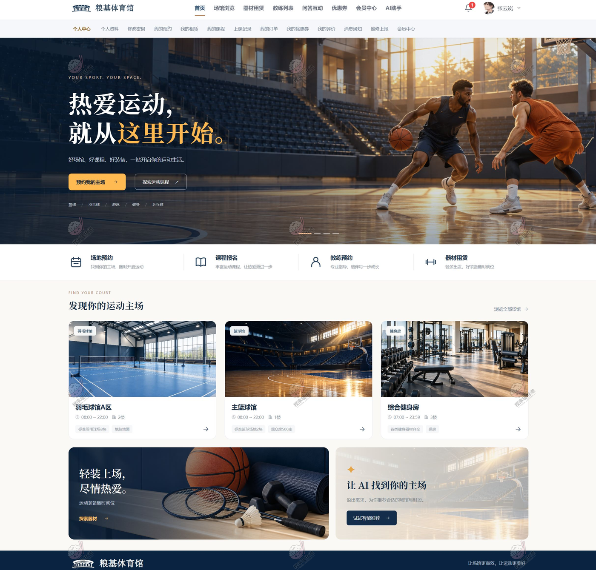
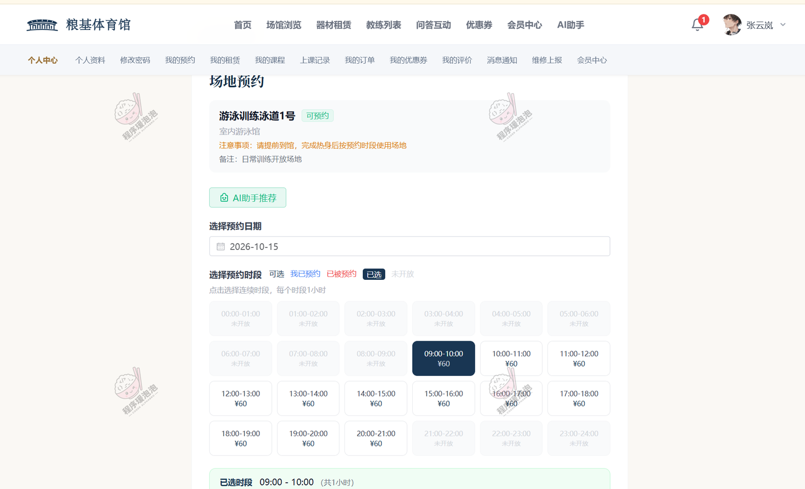
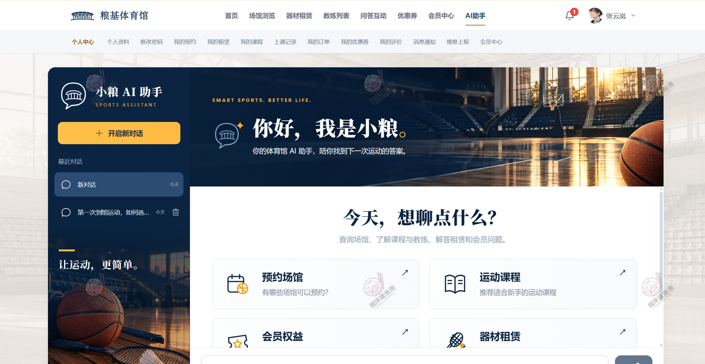
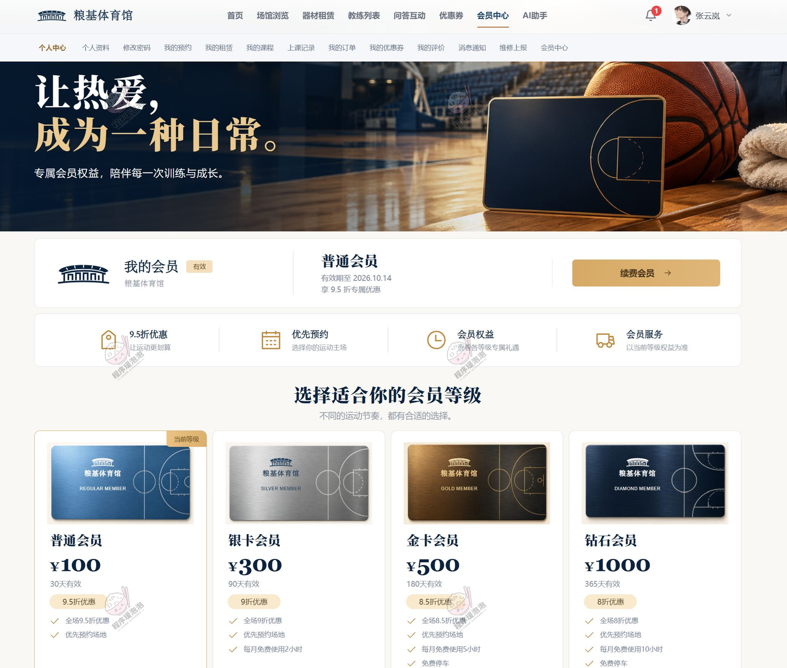
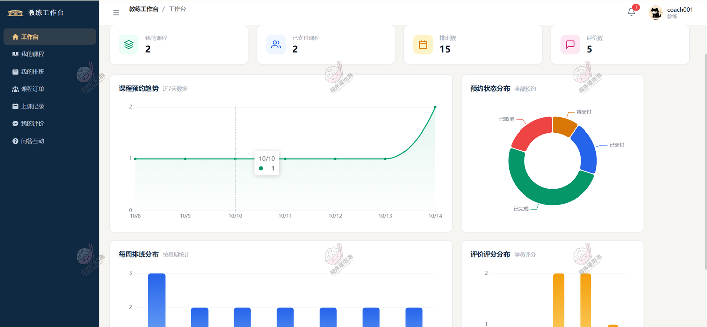
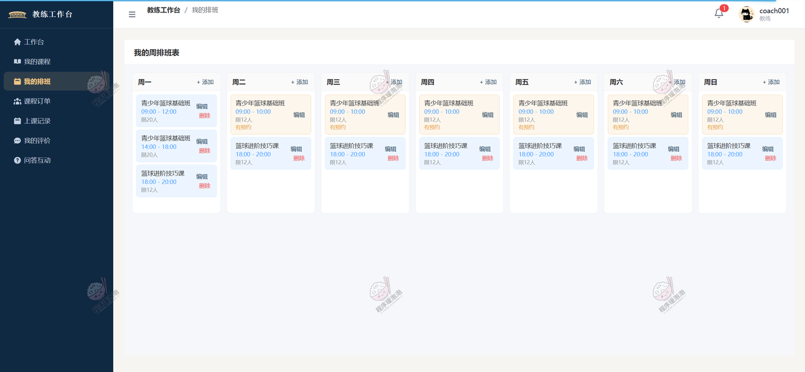
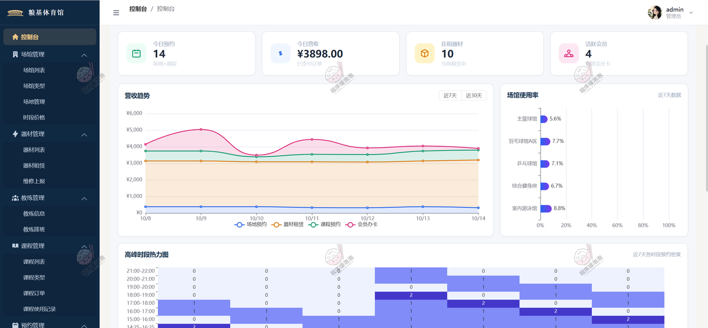
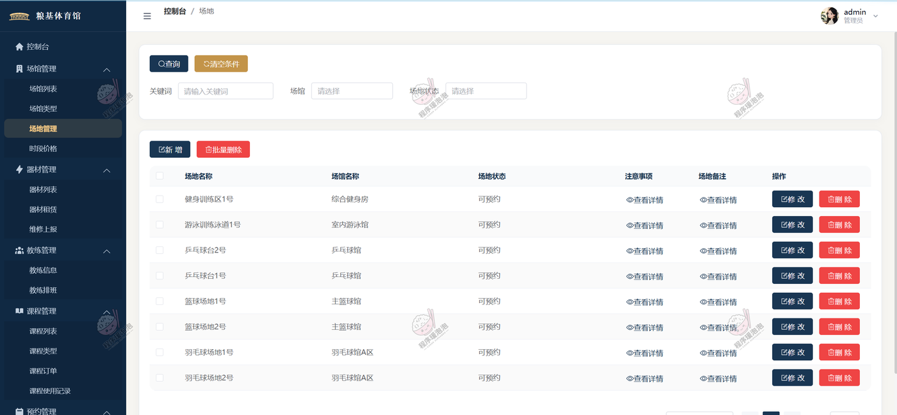
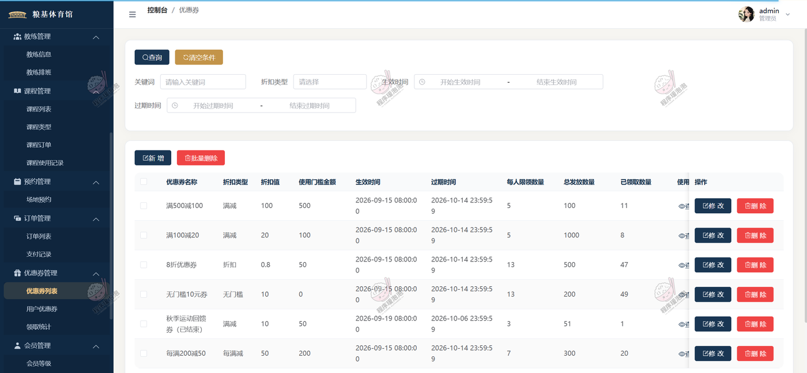

# SportsHall
体育馆预约管理系统 计算机毕业设计
亮点：AI运动助手、 协同过滤场馆推荐、zfb沙箱支付、邮箱验证码验证、 Redis并发控制、ECharts运营分析、场地预约流程、教练课程协作、器材租赁管理、会员与优惠联动；
角色：用户、教练、管理员；

所有源码均本人开发，项目是前后端分离的，所有的项目都具备了完整的业务逻辑，不仅仅局限于基础的增删改查（CRUD）操作，系统亮点众多。

本文注重于计算机毕业设计选题指导，列出题目均有源码， 大家可以去【公众号】(毕业终点站)获取或者加我【qq】(2112698948)提意见(别忘记Star哟)。备注：git

声明：仅用于学习使用，请勿用于任何商业行为！

1.系统非商用，非开源，非无偿。

2.由本人开发，如需源码，请联系以下方式，qq:2112698948。

3.项目有很多，并未全部上传，如果未找到想要的，可直接咨询。

# 体育馆预约管理系统

> 基于 Spring Boot 3 + Vue 3 的前后端分离体育场馆预约平台，用户 / 教练 / 管理员三角色协同。
> 集成 DeepSeek AI 运动助手、协同过滤场馆推荐、支付宝沙箱支付、邮箱验证码、Redis 并发控制、ECharts 运营分析、场地预约流程、教练课程协作、器材租赁管理与会员优惠联动。

## 一、项目简介

这是一套覆盖体育馆日常经营的 Web 平台。用户在网页上预约场地、买课程、租器材、办会员、领优惠券；教练用独立工作台管理课程、排班和上课记录；管理员统筹场馆、场地、订单和经营数据——三方围绕"运动服务"这条主线协作。

系统里几个花心思的地方：

- **AI 运动助手**：接入 DeepSeek，结合场馆、场地时段、课程和器材信息提供咨询与推荐，支持 SSE 流式回复和历史会话管理。
- **协同过滤场馆推荐**：后端基于用户场地预约与场馆评价构建交互矩阵，用余弦相似度找兴趣相近的用户算推荐分；未登录或缺少记录时按预约热度推荐。
- **Redis 并发控制**：场地预约按场地与日期加分布式锁，结合时段冲突校验减少重复预约；器材租赁支付时锁定对应器材并复查库存，降低多人同时租借造成的超扣。
- **支付宝沙箱支付**：场地预约、课程购买、器材租赁和会员办卡统一接入支付宝沙箱网关，支持支付表单生成与交易状态查询。
- **邮箱验证码验证**：注册邮箱发送 6 位验证码，5 分钟有效、60 秒重发间隔，验证成功即失效。
- **会员与优惠联动**：多等级会员支持在线办卡续费，场地预约可叠加会员折扣与优惠券，配合领券记录和统计。
- **场地预约流程**：按日期展示场地时段占用，支持连续时段选择、冲突检测、下单支付和后台核销。
- **教练课程协作**：用户查看教练和课程排班后购买课程，教练在独立工作台管理课程、排班与上课记录，管理员统一维护课程订单。
- **ECharts 运营分析**：数据看板、营收趋势和教练课程预约排行展示经营数据，WebSocket 推送业务通知。

## 二、技术栈

| 分层 | 技术 |
|---|---|
| 架构 | B/S、MVC、前后端分离，用户端 + 教练端 + 管理后台，多角色权限管理 |
| 后端 | Java、Spring Boot 3.3.1、Spring MVC、MyBatis-Plus、MySQL、Redis、JWT、WebSocket、SSE、DeepSeek、支付宝 SDK、阿里云 OSS、邮件验证码 |
| 前端 | Vue 3、Vite、Element Plus、Vue Router、Pinia、Axios、ECharts |
| 环境 | Windows / IDEA / JDK 17 / Maven / MySQL / Redis / Node.js |

## 三、系统功能

### 3.1 用户端
- 账号服务：邮箱验证码注册、登录、密码找回、资料维护、账号注销
- 首页浏览：轮播展示、场馆推荐、业务入口、AI 推荐入口
- 场馆浏览：关键词搜索、分类筛选、分页、地址设施、开放时间与评价查看
- 场地预约：日期选择、时段占用查看、连续时段选择、冲突检测、金额计算、会员折扣与优惠券
- 我的预约：预约记录、状态筛选、待支付倒计时、去支付、取消预约
- 器材租赁：器材列表详情、规格库存、租金押金、数量选择、租赁下单支付与记录
- 教练浏览：授课项目筛选、教练简介、资质评分、评价与可授课时间
- 课程服务：课程浏览、排班查看、购买支付、我的课程、上课记录
- 会员服务：等级权益展示、在线办卡、会员续费、当前等级与有效期
- 优惠券服务：领券中心、限领校验、规则有效期、未使用/已使用/已过期分类
- 订单服务：订单类型与状态筛选、详情、金额与优惠明细、支付结果查询、取消
- 问答互动：发布问题、搜索、详情、回答、多级评论、个人发布内容
- 评价反馈、消息通知、维修上报、协同过滤推荐、AI 助手

### 3.2 教练端
- 账号与资料：教练登录、密码修改、个人简介、资质证书、授课项目维护
- 教练工作台：课程与预约概览、常用功能入口
- 我的课程：课程查询、新增、编辑与删除，名称分类价格描述维护
- 我的排班：每周可授课时间设置、授课时段维护
- 课程订单：学员与预约信息、上课时间与状态、课程确认与取消
- 上课记录、我的评价、问答互动

### 3.3 管理端
- 用户管理：账号查询、新增、编辑、删除、角色筛选、禁用启用
- 场馆管理：场馆分类、信息、地址、开放时间、设施与图片
- 场地管理：场地信息、所属场馆、状态、收费标准、时段价格
- 预约管理：预约查询、详情、取消、使用核销、规则配置
- 教练管理、课程管理、器材管理、会员管理、优惠券管理
- 领券统计：领取趋势、使用趋势、券类型分布、排行、使用率对比
- 订单管理：交易订单查询、业务类型与状态筛选、金额明细、Excel 导出
- 内容管理、维修管理、运营维护、数据看板、统计图表

## 四、系统截图

以下选取 10 张代表性截图，按三个角色分别展示。源文档首图为登录入口页，未提供独立的系统总览图。

### 4.1 用户端

**首页** —— 轮播展示与场地预约 / 课程报名 / 教练预约 / 器材租赁四大入口，下方是推荐场馆卡片和"让 AI 找到你的主场"推荐入口。

**场地预约** —— 场地信息与注意事项、日期选择，时段网格用可选 / 已预约 / 被预约 / 已选 / 未开放五种状态展示占用情况，点击连续时段即可下单，是场地预约流程与冲突校验的落点。

**器材租赁** —— 器材卡片展示规格、租金、押金和库存，支持立即租赁；页面同时说明选器材、确认数量、完成租赁的简化流程。

**AI 助手** —— 小粮 AI 助手支持开启新对话与历史会话查看，欢迎页提供预约场馆、运动课程、会员权益、器材租赁四类快捷入口，对应 DeepSeek 多轮对话与 SSE 流式回复。

**会员中心** —— 展示当前会员等级与有效期、续费入口，以及普通 / 银卡 / 金卡 / 钻石四档会员卡的折扣与权益，配合优惠券形成会员优惠联动。

### 4.2 教练端

**工作台** —— 我的课程、已支付课程、排课数和评价数概览，配合课程预约趋势、预约状态分布、每周排课分布和评价评分分布。

**我的排班** —— 按周一到周日维护每周可授课时间，排课卡片显示课程名、时段和人数上限，支持编辑与删除，是教练课程协作的核心。

### 4.3 管理端

**控制台** —— 今日预约、今日营收、在租器材、活跃会员四项指标，配合营收趋势、场馆使用率和高峰时段热力图，是 ECharts 运营分析的总入口。

**场地管理** —— 按关键词、场馆和场地状态筛选场地，维护场地名称、所属场馆、注意事项和场地备注，支持新增与批量删除。

**优惠券管理** —— 配置满减、折扣、无门槛等券类型，维护折扣值、使用门槛、有效期、每人限领和总发放量，并查看已领取数量与使用率。

---

文档展示 10 张截图，需要了解更多，请联系我。
